English | [简体中文](./README-zh_CN.md) 

<h1 align="center">Spug</h1>

<div align="center">

Spug is a lightweight agent-free automatic operation and maintenance platform designed for small and medium-sized enterprises. It integrates host management, host batch execution, host online terminal, file management, application release and deployment, pipelines, online task planning, configuration center, monitoring, alarm and so on.

</div>


## Demo

Demo: https://demo.spug.cc (username `admin`, password `spug.cc`)

The demo environment runs the latest version and resets its data every hour, both the English and the Simplified Chinese interface are available from the globe icon in the header.


## Quick start

You need Docker 20.10.10 or later with the Compose plugin. The image runs on amd64 and arm64 and has the back end and the web UI built in, so nothing is downloaded when the container starts.

```bash
curl -fsSLO https://raw.githubusercontent.com/openspug/spug/4.0/docker-compose.yml
docker compose up -d
docker compose logs spug | grep password
```

Open `http://<your-server>/` and log in as `admin` with the password printed by the last command (it is generated on the first start). Time zone, port and database password are set in [docker-compose.yml](./docker-compose.yml), and the image is also published as `ghcr.io/openspug/spug`. For a quick look without the database container, `docker run -d --name spug -p 8080:80 openspug/spug:4.1` starts a single container on SQLite (get the password with `docker logs spug | grep password`). Upgrades and other ways to install are covered in the [installation guide](https://ops.spug.cc/en/docs/install-docker/).

Would you rather not run it yourself? We are looking into Spug Cloud, a hosted version where we run the control panel and reach your servers over SSH with a separate key for each one, so there is still no agent to install. If that sounds useful, [join the waitlist](https://spug.cc/cloud?lang=en&ref=github).


## 🔥Push Assistant 

Push Assistant is a message push platform that integrates multiple channels such as telephone, SMS, email, Feishu, DingTalk, WeChat, and WeChat Work. It can realize telephone and SMS alarms of Zabbix, Prometheus, Nightingale and other monitoring systems in 3 minutes. Click to experience: [https://push.spug.cc](https://push.spug.cc)


## Features

- **Host Management**: Manage hosts by group, import them from cloud providers or an Excel file, and check connectivity in batch
- **Host Batch Execution**: Support host batch online command execution, with parameterized commands, reusable templates and execution history
- **Host Online Terminal**: The host supports browser online terminal login
- **Host File Management**: Support host files online upload and download
- **File Distribution**: Distribute files and directories from one host to many hosts
- **Build and Deploy**: Support application custom build deployment, with review flow, canary release and rollback
- **Pipelines**: Orchestrate parameter, build, remote command, data transfer, data upload and DingTalk / Feishu / WeChat Work / Push Assistant notification nodes into a workflow, with conditional branches and a live console
- **Task Planning**: It supports online configuration of crontab, interval and other task schedules
- **Configuration Center**: Support KV, text, json and other formats online configuration
- **Monitoring Center**: Support site, port, process, ping, custom script and other monitoring
- **Alarm Center**: Support email, WeChat, DingTalk, WeChat Work, Feishu and other alarm methods
- **Credential Management**: Keep passwords and private keys in one place and share them across hosts
- **Permission Control**: Fine-grained role and permission control, LDAP login and MFA are supported
- **Bilingual UI**: Full English and Simplified Chinese interface, switchable from the header
- **Elegant and beautiful**: UI interface based on Ant Design
- **Open source and free**: The front-end and back-end code is completely open source


## Environment

* Python 3.8+
* Django 4.2
* Node.js 18+
* React 16.13
* Redis 5.0+

## Documentation

- Installation: https://ops.spug.cc/en/docs/install-docker/
- User guide: https://ops.spug.cc/en/docs/about-spug/
- Change log: https://ops.spug.cc/en/docs/change-log/
- FAQ: https://ops.spug.cc/en/docs/faq/
- Issues: https://github.com/openspug/spug/issues (English or Chinese are both welcome)
- Spug Push: https://push.spug.cc


## PreView

### Workbench
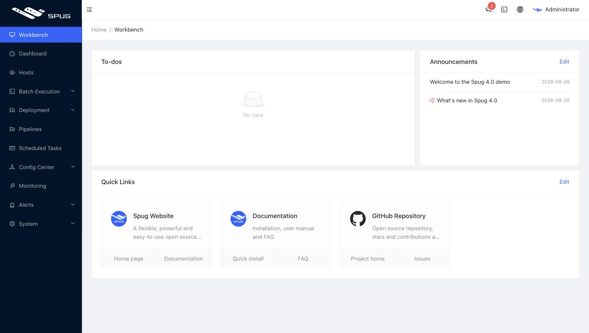

### Dashboard
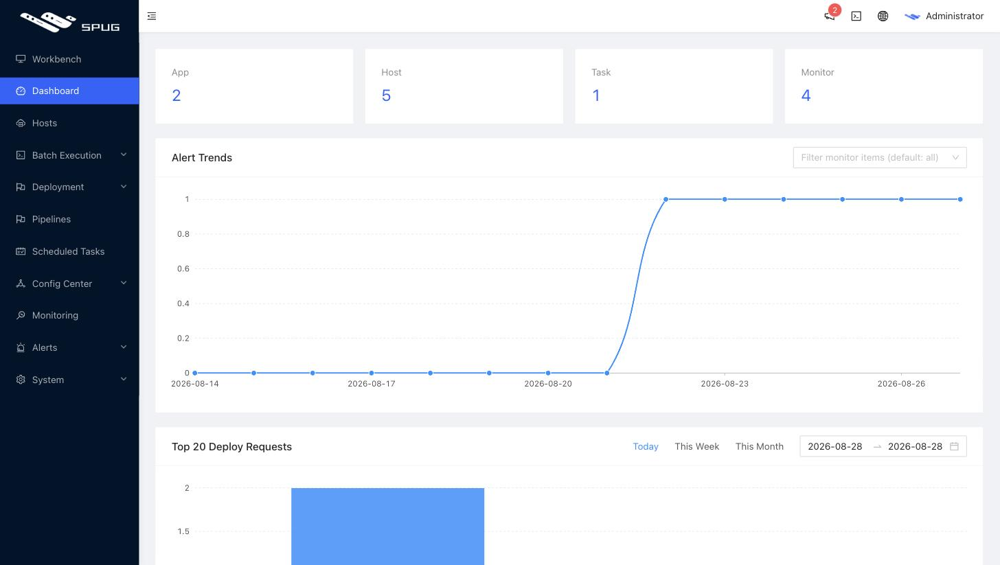

### Host Management
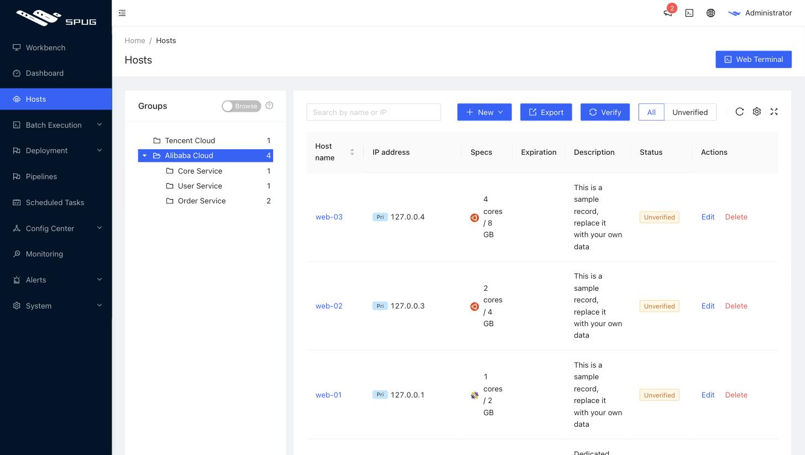

#### Host Online Terminal
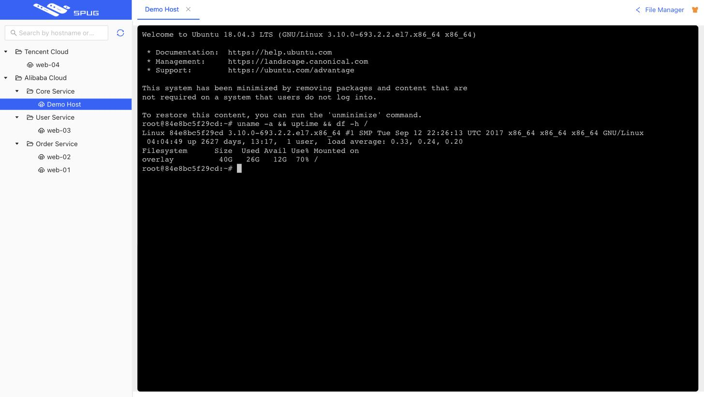

#### File Online Upload and Download
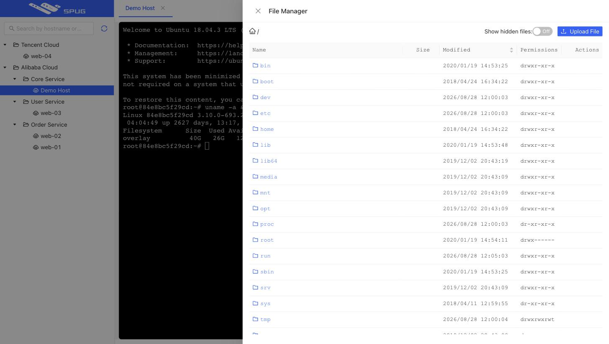

#### Host Batch Execution
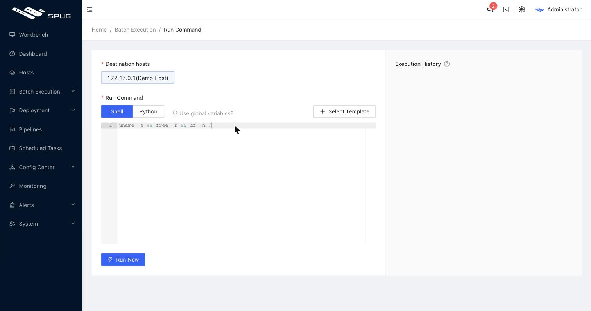
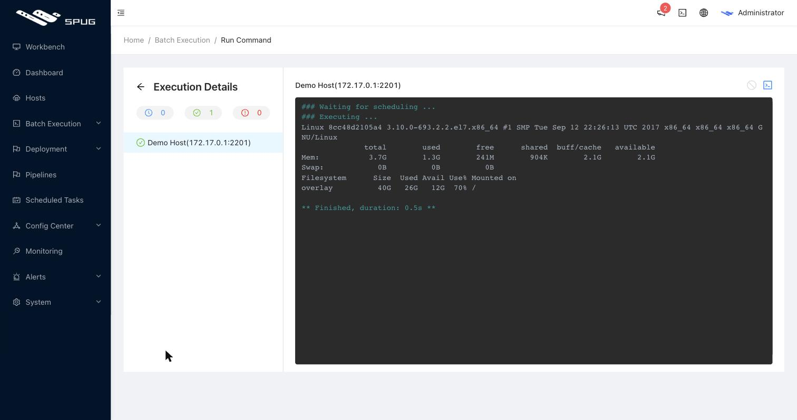

### Pipelines
Orchestrate build, command, data transfer, upload and notification nodes into a workflow.

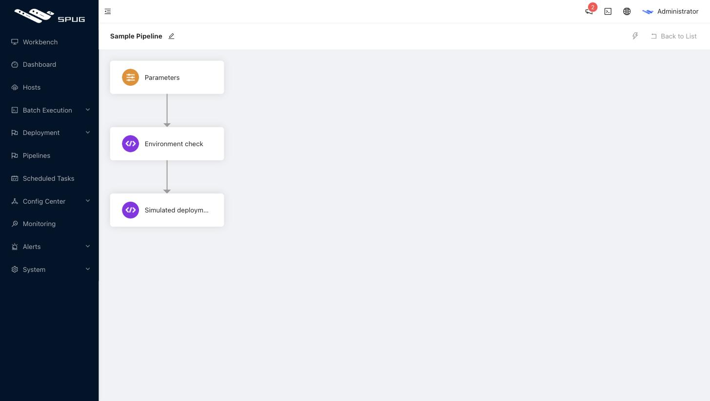
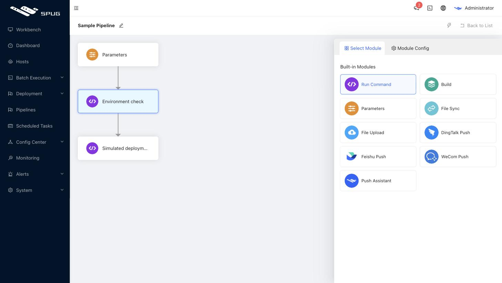
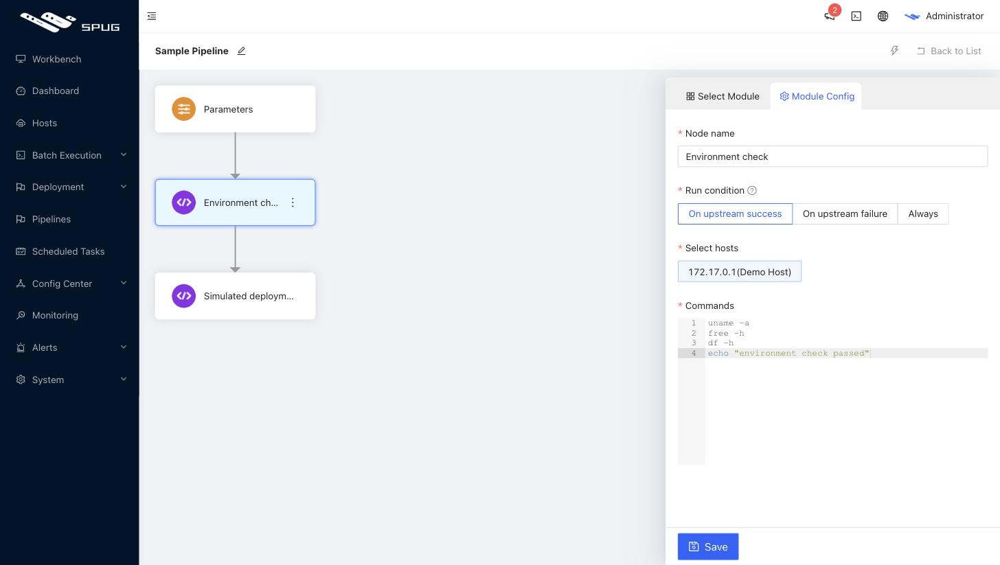
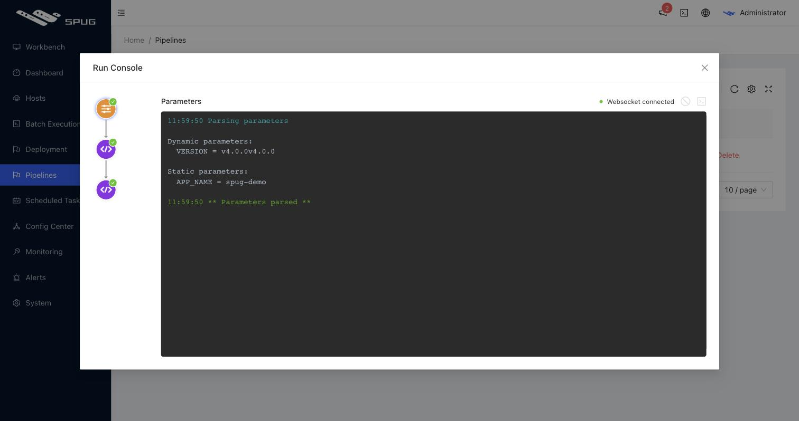

### Application Release
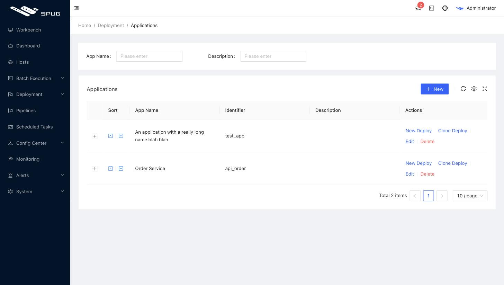
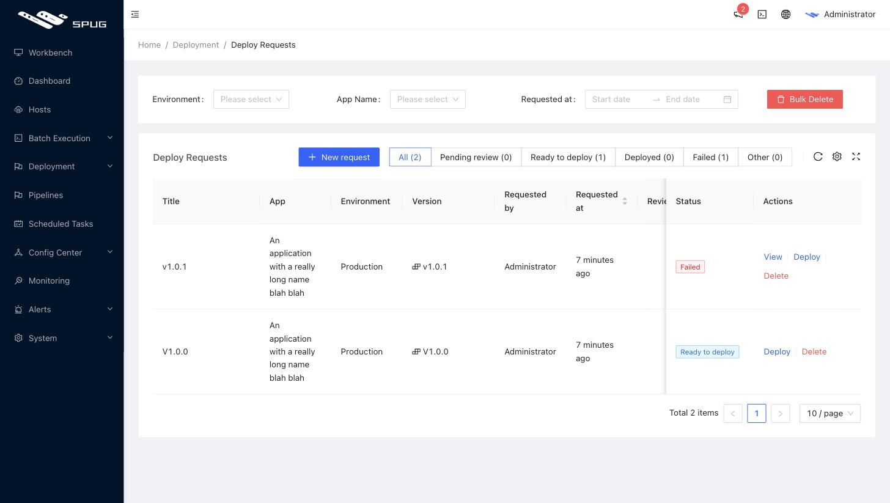
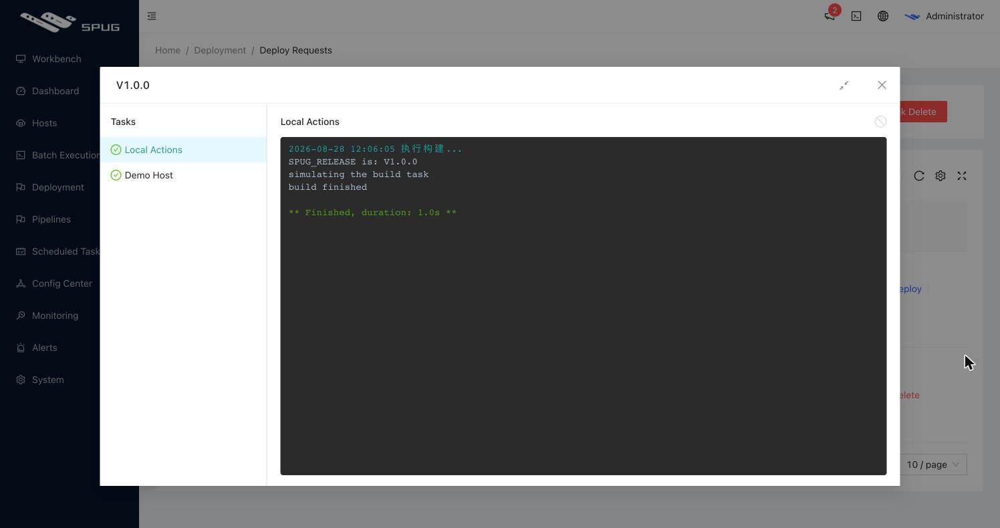

### Task Planning
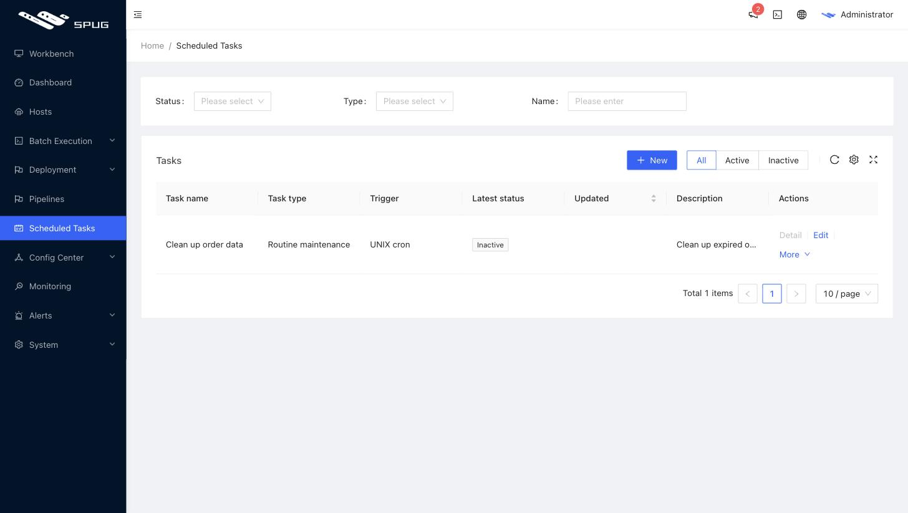

### Configuration Center
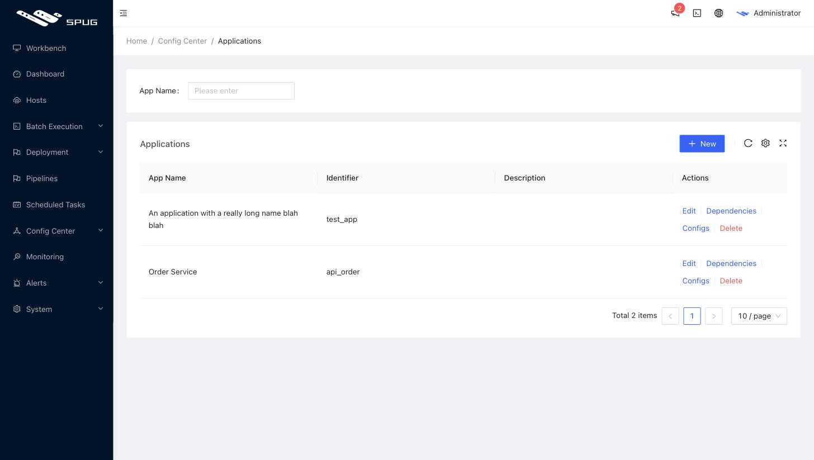

### Monitoring and Alarm
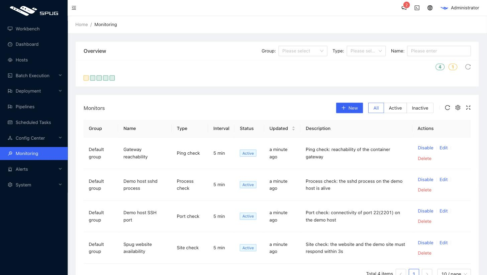
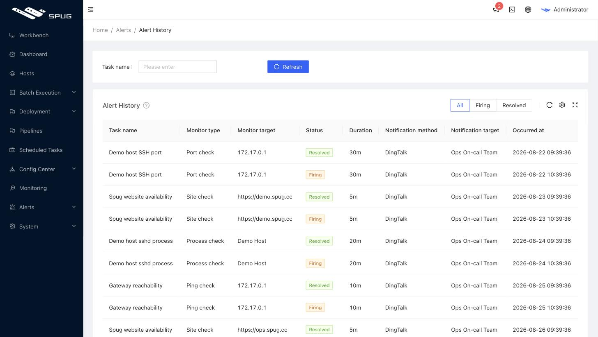

 
## License & Copyright
[AGPL-3.0](https://opensource.org/licenses/AGPL-3.0)
